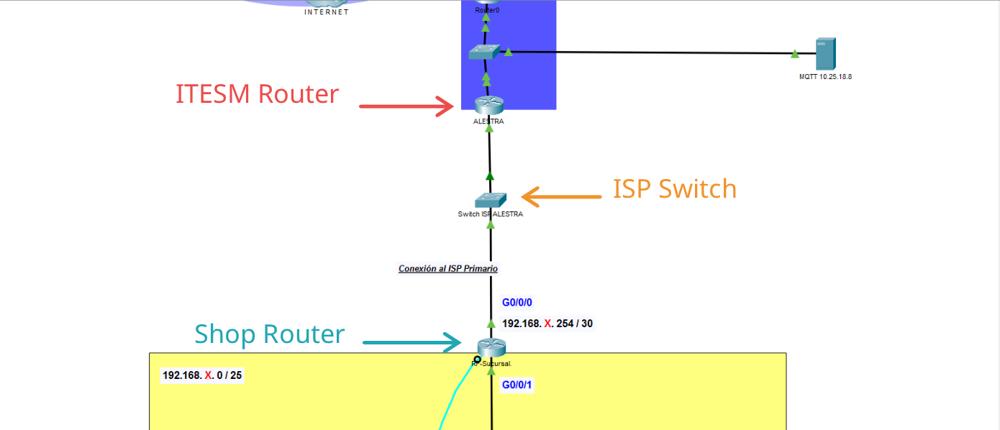
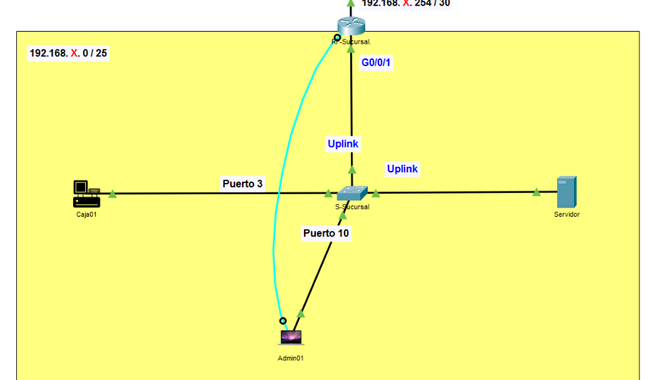
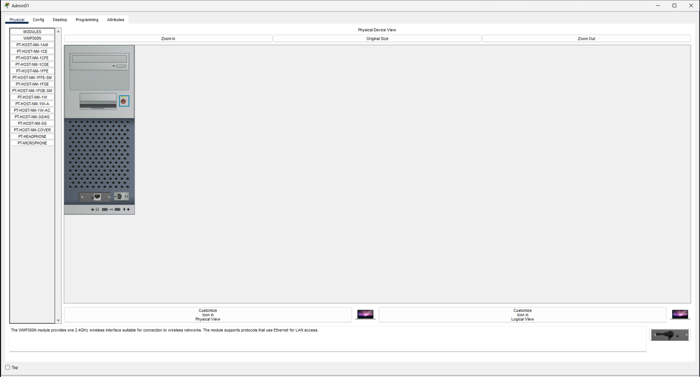
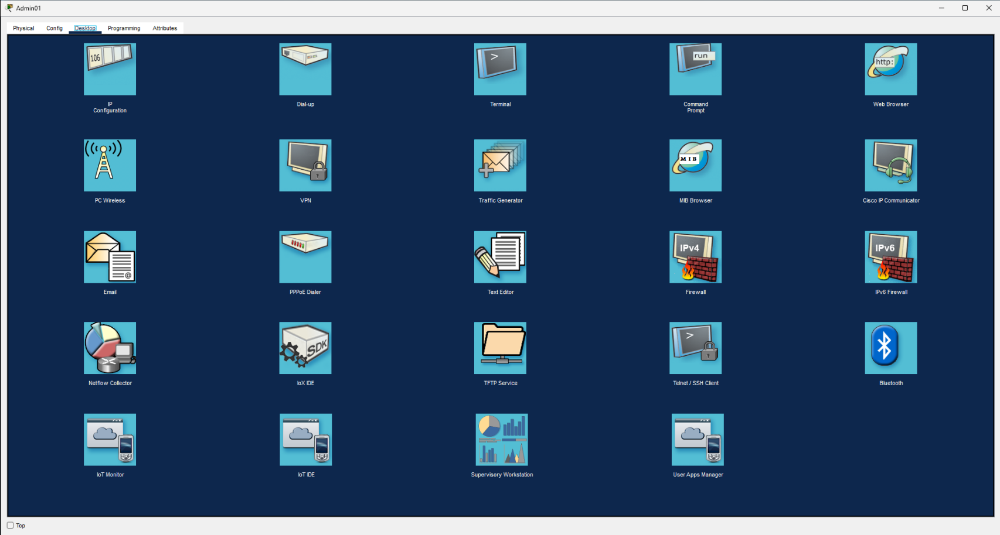
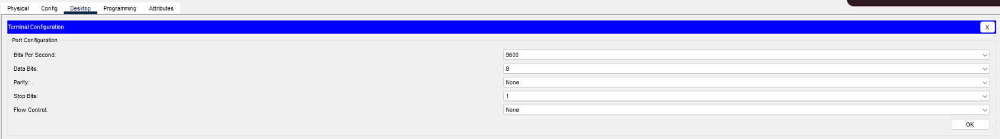
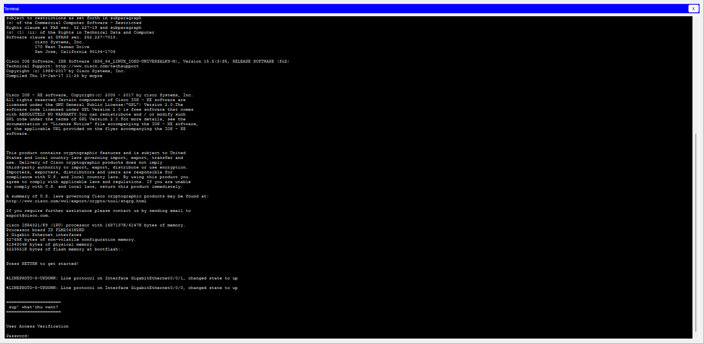
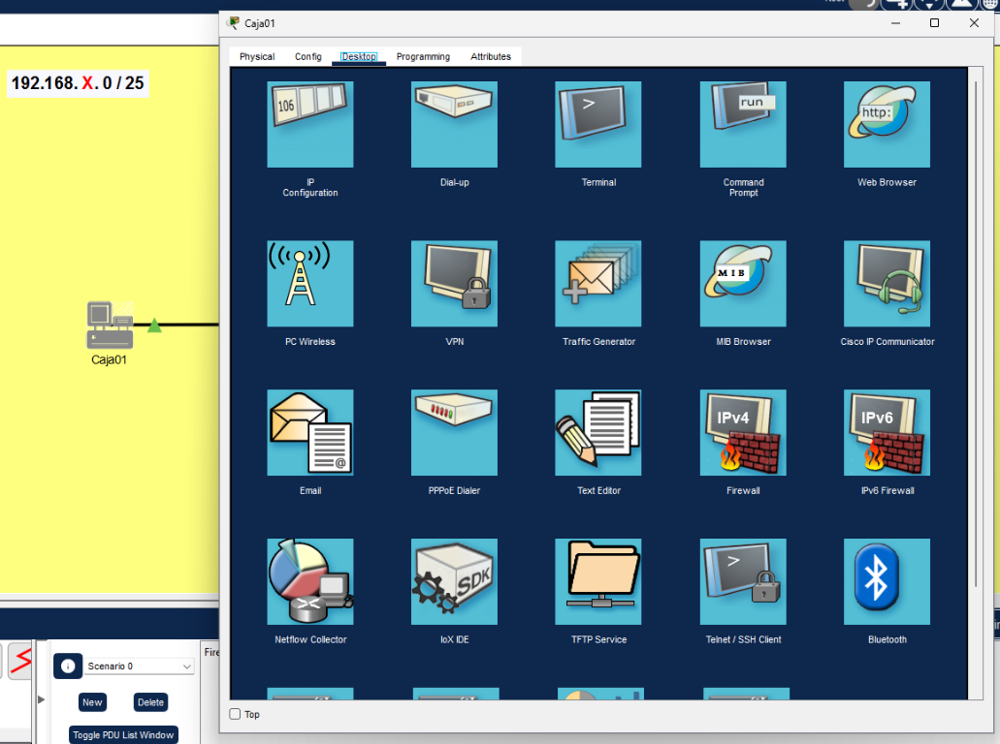
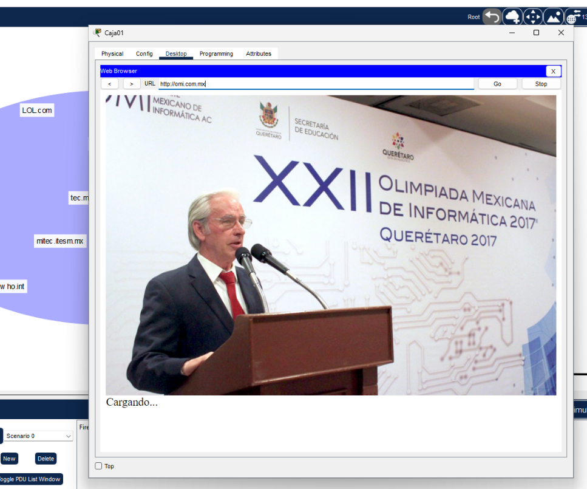

import { Card, Aside, Steps, Code, Tabs, TabItem } from '@astrojs/starlight/components';

We have been asked to help a famous food franchise establish themselves
on-campus by providing them with network connectivity using the on-site
services available at the institution.

They have already set up their internal structure, but they need internet
access. In order to do this, we must configure their router correctly and allow
it to handle inbound and outbound connections correctly.

As such, in this challenge, we will learn how to configure a Router device
using Cisco Packet Tracer by interfacing with the router's console. Let's
take a look at the existing connection diagram.

# Analyzing the Connection Layout



As we can see, we have three important connections between *ALESTRA*, *SWITCH
ISP ALESTRA* and *RF-Sucursal*. Their purpose is as follows:

Name | Description
|---|---|
ALESTRA | Our main ISP. This is the device that can provide us with an internet connection.
SWITCH ISP ALESTRA | The switch through which we will connect to ALESTRA.
RF-SUCURSAL | Our shop's router; the one we need to configure to conclude this activity.

In our case, we're connecting a shop over at Campus Toluca and we've been
allowed to connect our shop router to port **19** on the ISP's switch. Furthermore,
we have been given the following base IP to use: **192.168.190.0/24**.

# Configuring Our Router

In order to configure our router, we must access its console. Luckily, our
diagram includes a console port connection between a computer and our shop's
router which we can use to do this. Its the blue cable!



## Accessing the Router's Console

To establish a console conenction we must perform the following steps:

<Steps>
1. Click on the computer to open its configuration window.

2. Click on the *Desktop* tab to access the various services that the laptop provides.

3. Click on the *Terminal* icon to access a window where you can configure connection parameters to access an external device via your console connection. The default parameters should be sufficient for this activity.

4. Click on **OK**. You should now see the router's terminal, where we can begin to configure our device!

</Steps>

## Configuring the Router

In order to configure the router, we will need to run a series of Cisco IOS (Internetwork Operating System) commands.

:::note
In Cisco IOS, lines starting with an exclamation mark (`!`) are comments and are ignored by the shell. You can copy and paste command blocks directly into the terminal window.
:::

<Steps>

1.  ### Enter Privileged EXEC Mode & Set Clock

    We start in **User EXEC mode** (`RF-Sucursal>`). First, we need to escalate our privileges to access configuration features and manually set the system clock.

    ```ios title="Privileged Mode & Clock Setup"
    ! Escalate privileges to enter Privileged EXEC mode
    ! Notice the prompt changes from '>' to '#'
    enable

    ! Set the internal router clock (Format: HH:MM:SS Day Month Year)
    clock set 16:50:00 10 SEP 2026
    ```

2.  ### Access Global Configuration Mode

    Most configuration commands require us to be in **Global Configuration Mode**. 

    ```ios title="Global Configuration Mode"
    ! Enter global configuration mode from Privileged EXEC mode
    ! Notice the prompt changes from '#' to '(config)#'
    configure terminal
    ```

3.  ### Configure Router Identity & General Settings

    Next, we give our router a descriptive device name, disable unnecessary DNS network lookups to prevent shell freezing on typos, and set up a Message of the Day (MOTD) security banner.

    ```ios title="Device Identification & Global Settings"
    ! Assign a unique device hostname
    hostname RF-SucursalCTol

    ! Disable automatic domain lookup so mistyped commands don't trigger a hanging DNS search
    no ip domain lookup

    ! Define a login security/welcome banner displayed when accessing the device
    banner motd "
    ===================================================
     Authorized Access Only - Campus Toluca Branch
    ===================================================
    "
    ```

4.  ### Secure Console Line Access

    We must safeguard access to the router's physical console port by applying a password and optimizing the terminal prompt behavior.

    ```ios title="Console Security Configuration"
    ! Enter configuration mode for the primary physical console port
    line console 0

    ! Set the password required when connecting via console
    password tc2036

    ! Enable password prompt requirement on console login
    login

    ! Keep console output clean by preventing log messages from breaking up your typed commands
    logging synchronous
    ```

5.  ### Configure Network Interfaces (WAN & LAN)

    Now we configure the interfaces connecting our router to both the external ISP (WAN) and the local shop network (LAN).

    <Tabs>
      <TabItem label="GigabitEthernet 0/0/0 (WAN)">
        Connects the router externally to the ISP switch (`SWITCH ISP ALESTRA`) on port **19**.

        ```ios title="Interface G0/0/0 (WAN)"
        ! Enter interface configuration mode for GigabitEthernet 0/0/0
        interface G0/0/0

        ! Add an administrative label for easier identification
        description IF w/ ISP (WAN)

        ! Assign the public interface IP address and subnet mask
        ip address 192.168.190.254 255.255.255.252

        ! Power on the physical interface (interfaces are disabled by default in Cisco routers)
        no shutdown
        ```
      </TabItem>
      <TabItem label="GigabitEthernet 0/0/1 (LAN)">
        Connects the router internally to the shop's local network (LAN).

        ```ios title="Interface G0/0/1 (LAN)"
        ! Enter interface configuration mode for GigabitEthernet 0/0/1
        interface G0/0/1

        ! Add an administrative label for easier identification
        description IF w/ LAN

        ! Assign the internal gateway IP address and subnet mask
        ip address 192.168.190.126 255.255.255.128

        ! Power on the physical interface
        no shutdown
        ```
      </TabItem>
    </Tabs>

6.  ### Set Up the Default Gateway Route

    Finally, we create a static default route so any traffic bound for external networks (like the internet) knows to leave through the ISP interface (`G0/0/0`).

    ```ios title="Default Gateway Route"
    ! Add a default route (0.0.0.0/0 matches all unknown destination traffic)
    ! Outgoing interface: GigabitEthernet 0/0/0
    ip route 0.0.0.0 0.0.0.0 G0/0/0
    ```

</Steps>

:::tip[Verification]
Once you have entered all commands, you can exit to Privileged EXEC mode (`end` or `CTRL+Z`) and run `show ip interface brief` to verify that both interfaces are `up/up`.
:::

# Further Verification
If you ran the verification above and it all went well, you should now be able
to access the internet from within the shop's computers! Click on the Caja01
end device and go to the Desktop tab atop the window.



Open the web browser and type in one of the available URLs in the activity. I
chose https://omi.com.mx but you can choose whichever as long as its domain
resides within the blue cloud atop the design.


