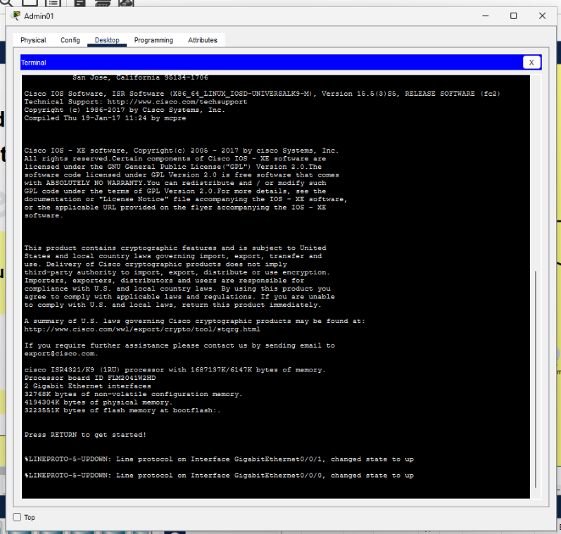
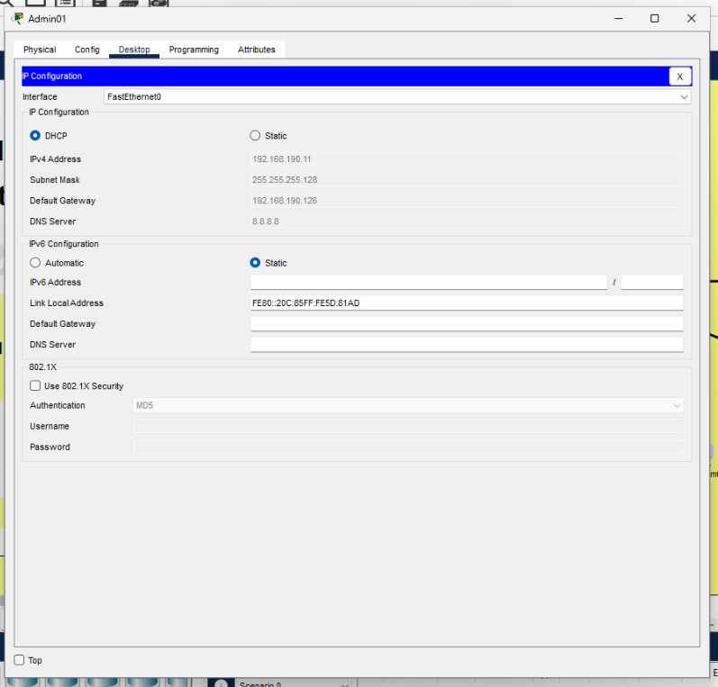
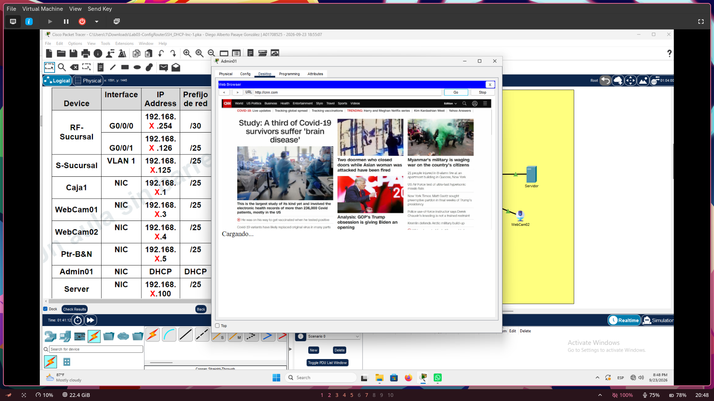
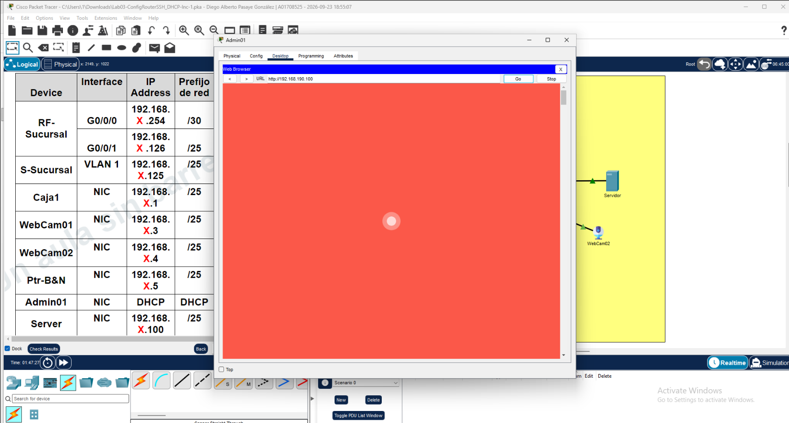
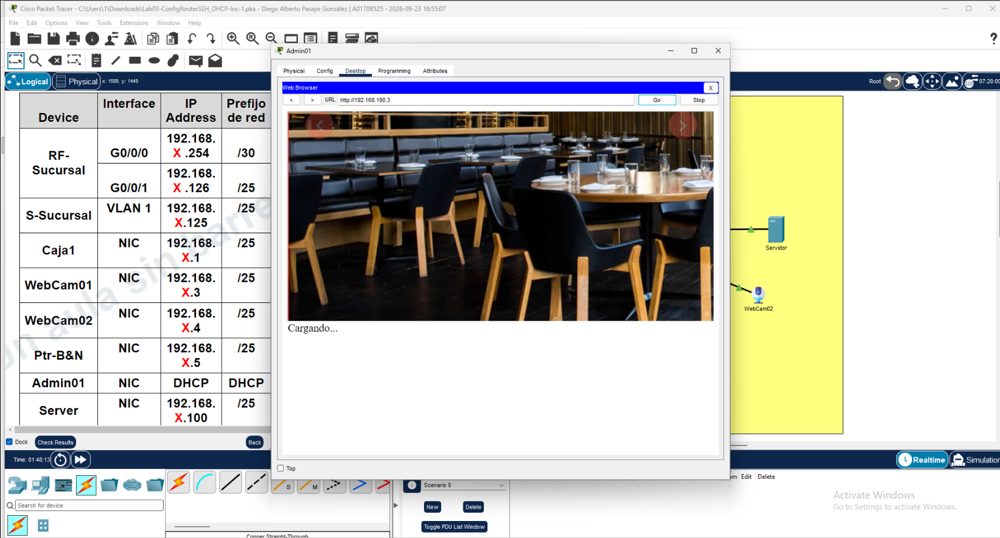
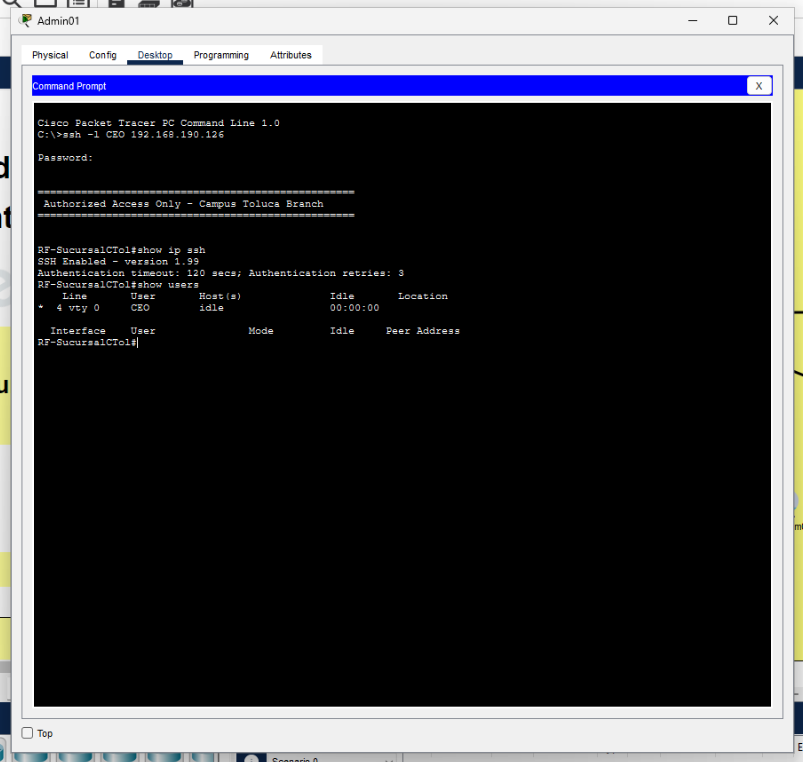

import { Steps, Tabs, TabItem } from '@astrojs/starlight/components';

The cafeteria is up and running, but there is a problem: every device in the
shop had to be configured by hand. Cashiers plug in a new terminal, and
nothing works until someone types in an IP address, a mask, a gateway and a DNS
server. On top of that, the only way to manage the router is by physically
walking up to it with a console cable.

In this challenge, we will build on top of the configuration from
[Challenge 01](../ch01/) to fix both issues. We will:

* Configure a **DHCP service** so devices receive their network settings automatically.
* Configure **default gateways**, both on the router (towards the ISP) and for the clients (through DHCP).
* Enable **SSH access** so the router can be managed securely from the network.

:::note
This challenge uses the same topology and the same base IP, **192.168.190.0/24**, as Challenge 01. The router is still connected to port **19** of *SWITCH ISP ALESTRA*.
:::

# Understanding the Address Plan

Before typing any commands, it helps to know where every address comes from.
Our /24 block has been split into two subnets:

Network | Mask | Usable range | Purpose
|---|---|---|---|
192.168.190.0/25 | 255.255.255.128 | .1 to .126 | Shop LAN (`G0/0/1`)
192.168.190.252/30 | 255.255.255.252 | .253 to .254 | Link to the ISP (`G0/0/0`)

The addresses we'll reserve inside the LAN subnet are:

Address | Use
|---|---|
192.168.190.126 | The router's LAN interface. This is the **default gateway** for every client.
192.168.190.1 - .10 | Reserved for infrastructure (switches, printers, access points, and so on).
192.168.190.100 | Reserved for a server with a static address.

Everything else in the LAN range is fair game for DHCP.

# Configuring Our Router

Just like last time, we will use the console connection to enter our commands.
The steps to open the terminal are the same as in Challenge 01.

## Accessing the Router's Console

:::caution
Challenge 01 protected the console with a shared line password. In this challenge we replace it with **local user accounts**. Once you apply the new configuration, the console will ask for a *username* and *password* instead of just a password.
:::



## Configuring the Router

Once again, we will run a series of Cisco IOS commands. Remember that lines starting with `!` are comments and are ignored, so you can paste whole blocks at once.

<Steps>

1.  ### Enter Privileged EXEC Mode & Set Clock

    As before, we escalate our privileges and set the clock. An accurate clock matters more than it seems: SSH keys and log messages are timestamped with it.

    ```ios title="Privileged Mode & Clock Setup"
    ! Escalate privileges to enter Privileged EXEC mode
    enable

    ! Set the internal router clock (Format: HH:MM:SS Day Month Year)
    clock set 16:50:00 10 SEP 2026

    ! Enter global configuration mode
    configure terminal
    ```

2.  ### Configure Identity & Domain

    We keep the hostname, the DNS lookup setting and the banner from before, but add one new command: `ip domain name`.

    ```ios title="Identity & Domain"
    ! Assign a unique device hostname
    hostname RF-SucursalCTol

    ! Disable automatic domain lookup so mistyped commands don't trigger a hanging DNS search
    no ip domain lookup

    ! Set the domain name (required before generating the RSA key below)
    ip domain name lacafe.com.mx

    ! Login banner displayed on access
    banner motd "
    ===================================================
     Authorized Access Only - Campus Toluca Branch
    ===================================================
    "
    ```

    :::tip[Why do we need a domain name?]
    SSH identifies the router by its *fully qualified domain name*, which is the hostname plus the domain (here, `RF-SucursalCTol.lacafe.com.mx`). IOS uses this name when generating the encryption keys, so it refuses to create them until both are set.
    :::

3.  ### Create Local User Accounts

    A single shared password is not enough for remote access, because we want to know *who* is connecting. We create a local user database instead.

    ```ios title="Local User Accounts"
    ! Used by 'login local' on the console and vty lines below
    ! Privilege level 15 is the maximum (full administrative access)
    username CEO privilege 15 secret tc2036
    username CIT privilege 15 secret tc2036
    ```

    The `secret` keyword stores the password as a hash, unlike `password`, which is stored in a weaker, reversible format.

4.  ### Generate the SSH Keys

    SSH encrypts traffic using an RSA keypair that the router generates for itself. This is what makes it a secure replacement for Telnet.

    ```ios title="RSA Key Generation"
    ! Generates the RSA keypair needed for SSH; requires hostname + domain name to already be set
    crypto key generate rsa mod 1024
    ```

    The `mod 1024` part sets the key size (modulus) in bits.

5.  ### Secure the Console and Remote Lines

    Both the physical console and the *virtual terminal* (vty) lines now authenticate against the local user database with `login local`. The vty lines are the virtual "ports" that incoming remote sessions use.

    <Tabs>
      <TabItem label="Console Line">
        ```ios title="Console Line"
        line console 0
         ! Authenticate against the local user database instead of a line password
         login local
         ! Keep console output clean by preventing log messages from breaking up typed commands
         logging synchronous
        ```
      </TabItem>
      <TabItem label="VTY Lines (SSH)">
        ```ios title="VTY Lines"
        line vty 0 1
         ! Allow 0-1 connections (2 total allowed)
         login local
         ! Only permit SSH, no unencrypted Telnet
         transport input ssh
         logging synchronous
        ```

        `line vty 0 1` gives us two simultaneous sessions. The command `transport input ssh` rejects any Telnet attempt, so credentials never travel in plain text.
      </TabItem>
    </Tabs>

6.  ### Configure the Network Interfaces (WAN & LAN)

    These are the same as in Challenge 01. If you are building on top of your previous work, they are already in place, but it is harmless to enter them again.

    <Tabs>
      <TabItem label="GigabitEthernet 0/0/0 (WAN)">
        ```ios title="Interface G0/0/0 (WAN)"
        interface G0/0/0
         description IF w/ ISP (WAN)
         ip address 192.168.190.254 255.255.255.252
         no shutdown
        ```
      </TabItem>
      <TabItem label="GigabitEthernet 0/0/1 (LAN)">
        ```ios title="Interface G0/0/1 (LAN)"
        interface G0/0/1
         description IF w/ LAN
         ip address 192.168.190.126 255.255.255.128
         no shutdown
        ```
      </TabItem>
    </Tabs>

7.  ### Set Up the Default Gateway Route

    This is the router's own default gateway: the way out to the internet.

    ```ios title="Default Gateway Route"
    ! Default route: send all unmatched traffic out the WAN interface
    ip route 0.0.0.0 0.0.0.0 G0/0/0
    ```

    There are two "default gateways" in this network, and it is easy to mix them up:

    Who | Gateway | Configured with
    |---|---|---|
    The router | Out through `G0/0/0` (the ISP) | `ip route 0.0.0.0 0.0.0.0 G0/0/0`
    The shop's computers | 192.168.190.126 (the router's LAN interface) | `default-router` in the DHCP pool (next step)

8.  ### Configure the DHCP Service

    Finally, we let the router hand out addresses. We first decide which addresses DHCP must **never** give away, and then describe the pool.

    ```ios title="DHCP Service"
    ! Exclude a range from the DHCP pool
    ip dhcp excluded-address 192.168.190.0 192.168.190.10
    ! Exclude single IPs (e.g. reserved/static hosts)
    ip dhcp excluded-address 192.168.190.100
    ip dhcp excluded-address 192.168.190.126

    ip dhcp pool Pool-CTol
     network 192.168.190.0 255.255.255.128
     default-router 192.168.190.126
     dns-server 8.8.8.8
    ```

    Let's break down what each piece does:

    Command | What it does
    |---|---|
    `ip dhcp excluded-address` | Removes addresses from the pool. We protect the reserved infrastructure range, the server at .100 and the router's own address (.126), so no client is ever given an address that is already in use.
    `ip dhcp pool Pool-CTol` | Creates a pool with a descriptive name and enters DHCP configuration mode.
    `network` | The subnet the pool serves. Clients will receive addresses from this range.
    `default-router` | The default gateway that clients will be told to use.
    `dns-server` | The DNS server that clients will use to resolve domain names. We use Google's public DNS.

    :::note
    Excluded addresses must be declared **before** clients request leases. Excluding them afterwards will not revoke leases that were already handed out.
    :::

</Steps>

:::tip[Save Your Work]
Configuration lives in RAM until you save it. Once you finish, exit with `end` and run `copy running-config startup-config` so it survives a reboot.
:::

# Verifying the Configuration

We have three new services to check, so let's verify them one by one.

## Checking DHCP

Go to any end device in the shop, open its *Desktop* tab, go to *IP Configuration* and select **DHCP** instead of Static. After a moment, the device should receive its settings automatically.



You should see an address in the 192.168.190.11 - .125 range (skipping .100), the mask 255.255.255.128, the gateway 192.168.190.126 and the DNS server 8.8.8.8.

On the router you can also inspect the leases it has handed out:

```ios title="DHCP Verification"
show ip dhcp binding
show ip dhcp pool
```

## Checking Internet Access

Now that clients get a gateway and a DNS server automatically, browsing should work without any manual setup. Open the web browser on the device and visit one of the activity's URLs.



## Checking Local Connectivity

Internet access is not the only thing that matters. Devices in the shop must also be able to reach each other. Our server sits on the same LAN, so from a client's *Command Prompt* try pinging it:

```
ping 192.168.190.100
```



This also works for our *network cameras*:



:::note
Since the server and the client are in the same subnet, this traffic stays on the LAN and never needs to go through the router.
:::

## Checking SSH Access

Last but not least, we make sure we can manage the router remotely. From the *Command Prompt* of any computer in the shop, connect to the router's LAN address using one of the accounts we created:

```
ssh -l CEO 192.168.190.126
```

The router will show the banner and ask for the password (`tc2036`). If everything went well, you will land at the router's prompt without ever touching the console cable!



To double-check the SSH service from the router itself, you can run:

```ios title="SSH Verification"
show ip ssh
show users
```

:::caution[Extra Hardening]
This configuration allows only two simultaneous sessions, so a third user will be rejected until one disconnects. You may also want to add `ip ssh version 2` in global configuration mode to force the more secure SSH version 2.
:::

# Wrapping Up

In this challenge, we replaced manual, error-prone setup with a router that:

* Hands out addresses, gateways and DNS servers through **DHCP**.
* Knows how to reach the outside world through a **default route** and tells its clients to use it as their **default gateway**.
* Can be managed securely over **SSH** using individual **local user accounts**.
