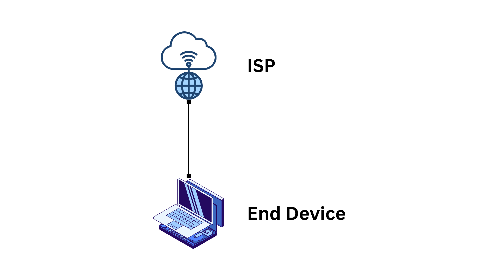
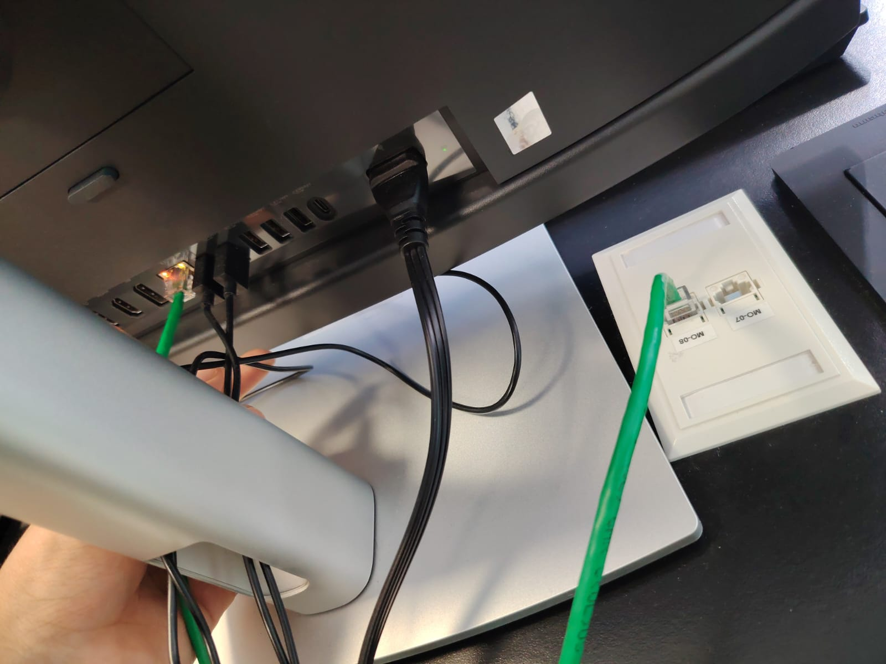
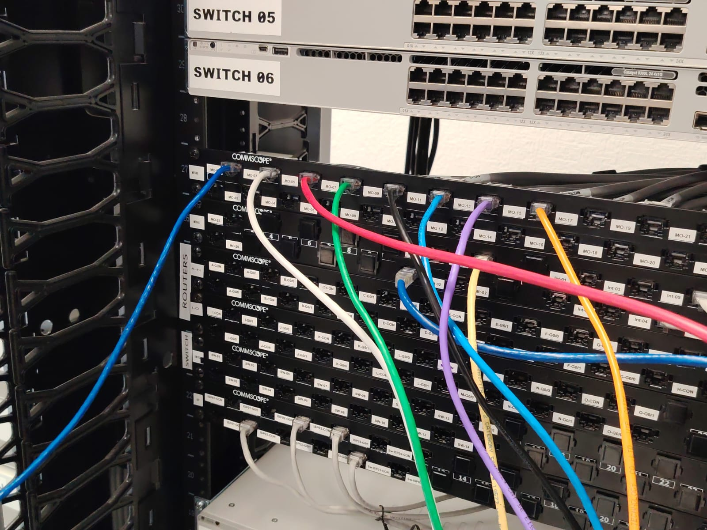
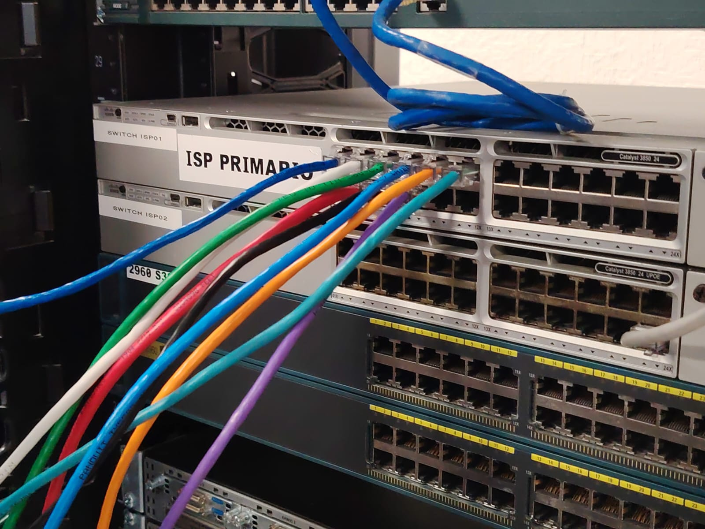
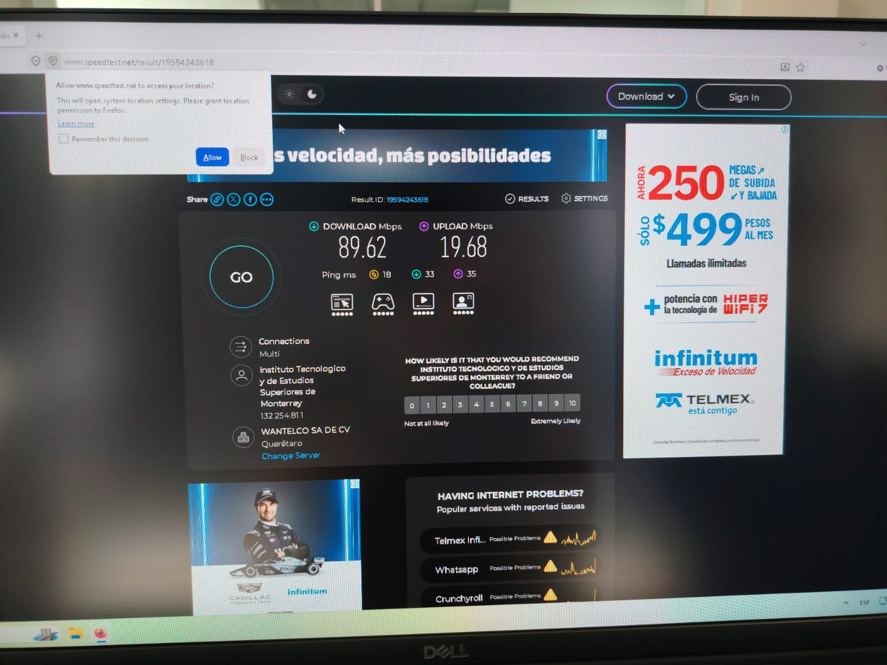
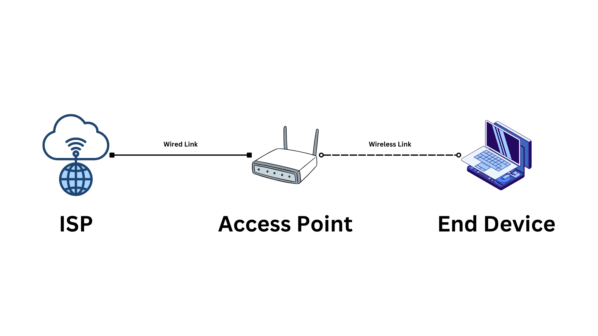
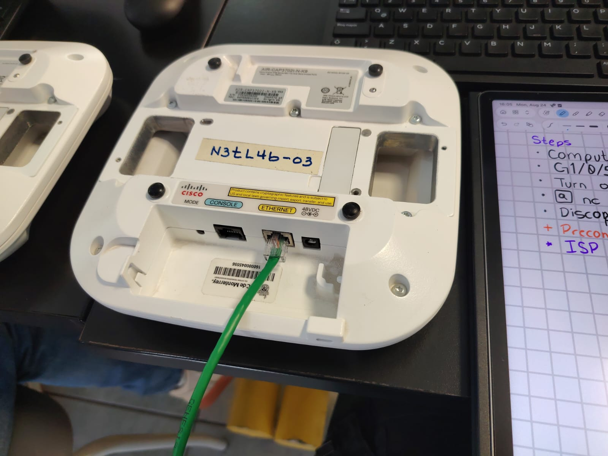
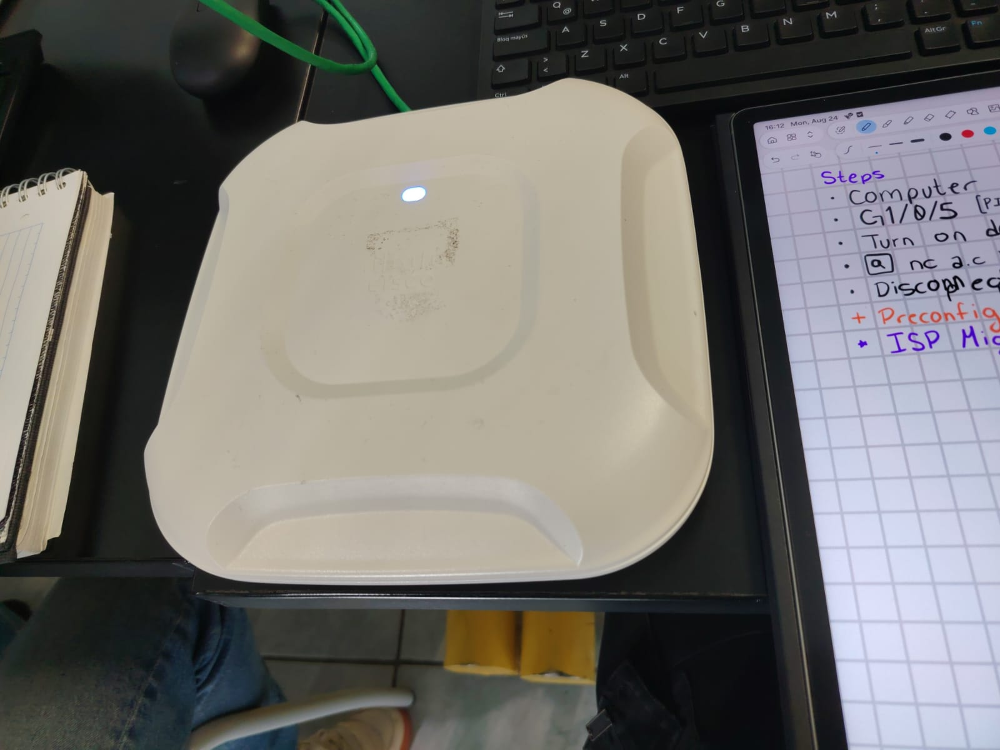
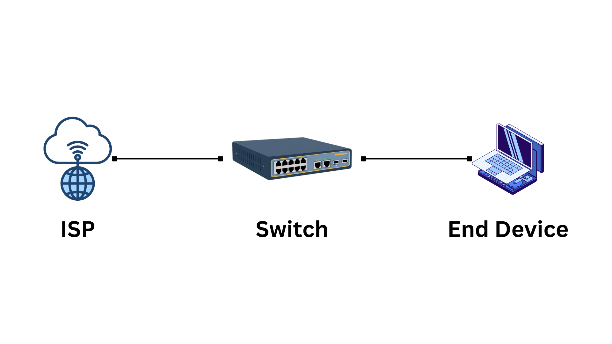
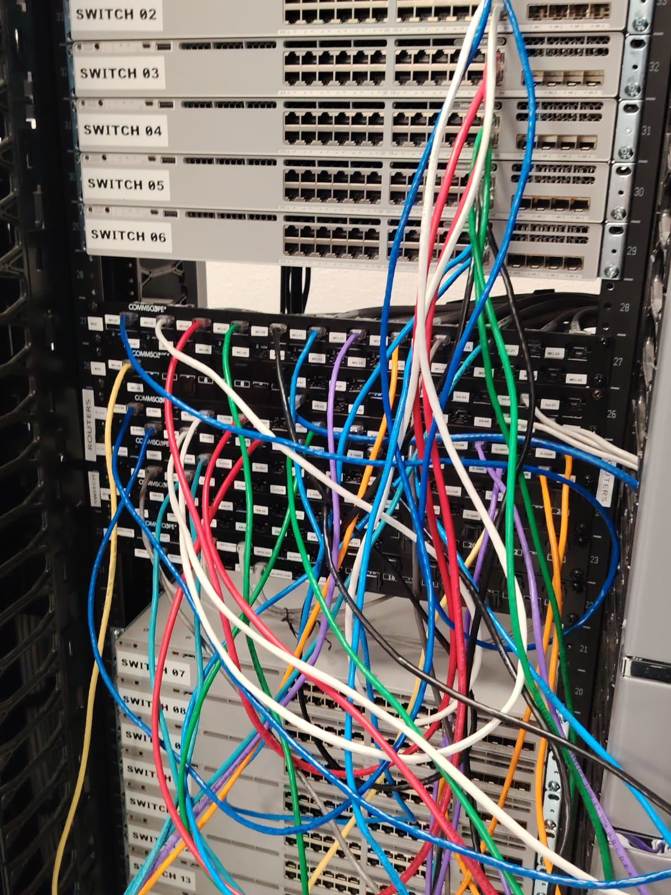

import { Card } from '@astrojs/starlight/components';
import { Aside } from '@astrojs/starlight/components';

In this first activity, we will interconnect a variety of devices by following a set of defined topologies.
However; before we begin our duties, we must recognize the facilities that the network laboratory
has to offer.

## Resources in the Network Laboratory
| Resource     | Description
|--------------|---------------------|
| Faceplate    | A network outlet embedded on each of the tables in the network lab. Each patch panel has two RJ45 outputs. There is one patch panel per computing device. |
| Patch Panel | Provides a direct connection to the faceplate on the table. Each port on the patch panel is labelled with a number that corresponds to a numbered port on the faceplate. |
| ISP          | The ISP provides an internet connection to the devices connected to it. |
| ISP + PoE    | This is an alternative version of the ISP which provides Power over Ethernet. |

## Direct Connection with an ISP
The simplest connection we can make is one where we simply connect a device directly to the ISP.
There are no other devices in between, just one simple connection.

<Card title="Risks Associated with this Topology" icon="warning">
    While this is a valid setup, it is also really insecure. Connecting
    your device directly with the ISP allows people on the network to target
    your device directly without having to go through a firewall or network
    management rules and it doesn't allow you to create network segments.
    It is important to install a router in between the ISP and your devices to
    increase security.
</Card>

In order to do this, we will connect our end device to a port on the faceplate. In this case, I chose port 8.

Then, we will connect port 8 on the patch panel to a port on the ISP. First, I chose patch panel port 8,
which corresponds to the port on the faceplate.

Finally, I chose port G1/0/5 on the ISP.

### True Network Speeds

<Card title="Achievable Network Speeds" icon="analytics">
    Theoretically, you could reach speeds up to what the ISP provides, only
    limited by the speed of the port you chose to connect to. In this case, we
    should ideally be seeing speeds of around 1 Gbps, however, we'll soon see
    that this is far from our case.
</Card>

We should confirm that our computer does, in fact, receive an internet
connection. The easiest way to confirm this would be to access a resource
within the network. In this case, we will confirm our connection by running
`ncpa.cpl` on the Windows search bar.

An executable file should appear. Run it and a window similar to this one
should pop up:

This is great! We can see that we are receiving 1.0 GB/s of data transfer
speed, but it doesn't quite feel like it, does it? We can perform a network
speed test in order to obtain data that is closer to reality. Try searching
for a speed test online! In this case, I used
[This site](https://www.speedtest.net/).

As you can see, our download speed is less than 10% of what we should be
receiving. Even worse, our upload speed is just short of 2% of what we should be
getting. What is going on?

<Card title="Network Traffic" icon="cloud-download">
    Usually, there are many devices connected to a single network. This creates
    a lot of what is known as *network traffic*. If many devices are trying to
    access the same resources and said resources can't handle all of the
    requests, the rate at which data is delivered will be lower, slowing the
    entire network down.

    Usually, if download speed is lower than upload speed, it means that there
    is way too much network traffic.
</Card>

## Using an Access Point

A slightly similar topology can be achieved through the use of an Access Point,
also known as an AP. In this topology, we will connect an AP directly to the
ISP and connect our end device from there.

In this case, we will be using a preconfigured AP so we won't have to modify
any configuration parameters. This AP has been configured with a secure network
that has a given SSID and corresponding password.

In the following picture, we can observe the bottom of the AP we will be using.

Here we can see three different ports we can plug connections into:
- The leftmost port is a console port, which allows a user to connect a computer to configure the AP.
- The middle port is an ethernet port, by which we can provide the AP with an internet connection.
- The last port is a power port, with which we can supply power to the AP. In fact, we can provide power to an AP in multiple ways:
  - Using the AP's power source.
  - Using a PoE enabled connection.
  - Using a PoE Injector to create a PoE enabled connection.

In this case, we did the same steps we did before but, instead of connecting
the faceplate to the computer, we connected it to the AP. Once running, we
should be able to spot the network's SSID by scanning for nearby networks on
a device that can connect to wireless networks.

When we connect at least once device to the AP, its top light should turn blue!

<Card title="Multiple Radio Frequencies" icon="link">
    If you try this with multiple APs, you might notice that you can run 2.4
    GHz and 5 GHz APs within small spaces. Both of these standard speeds' bands
    exist on different Radio Frequencies which are separated enough from each
    other to not cause a collision between the data that is being sent on each
    network.
</Card>

## Adding a Middle Switch

Both of these topologies work but, as we've mentioned, we're exposing our
devices directly to the ISP's network. While we won't add a router just yet, we
will revisit the first topolofy and add a switch between the ISP and the
computer. This will allow us to separate the ISP and the End Device a bit more
and begin creating network segments.

In order to do this, we will introduce a pair of new cable to the mix. First,
our switch needs to be able to provide a network connection. As such, we will
connect the switch to the ISP. After that, we will connect the switch to the
corresponding patch panel port that connects back to our faceplate.

In the following image, each pair of colored cables follows the same topology.
Feel free to follow your favorite color!. Any cable exiting to the right of the
image is connecting directly to a port on the ISP.

<Aside type='caution'>While technically complete, these instructions are
    missing detailed process graphics. More images will be added to the site
    soon!</Aside>

After this is done, connect your end device to the faceplate on the table.
You should now have a network connection managed through a switch!

<Card title="Minimum Common Speeds" icon="link">
    You may remember that our ISP provided around 1 GBps of network transfer
    speed. Well, what if your switch only has 100MBps ports? When two devices
    have different maximum transfer speeds, they will use the lowest common
    speed to communicate in order to ensure that no packets or general data is
    lost in transit.
</Card>

This concludes activity 01!
