import { Card } from '@astrojs/starlight/components';
import { Aside } from '@astrojs/starlight/components';

In the previous lab, we interconnected devices in the network laboratory
using cables, switches and access points. In this activity, we will take a step
further: we will configure a real router using the same Cisco IOS commands that
we practiced in [Challenge 02](../../challenges/ch02/), but this time on
physical equipment.

The lab was carried out over two sessions. In the first one, we established
a direct connection to the ISP and prepared the console cable. In the second
one, we configured the router and began working on a VLAN.

## Connecting a Computer Directly to the ISP

Just like in Lab 01, we begin with the simplest possible topology: a computer
connected directly to the ISP. First, we connect our computer to a port on the
patch panel that sits on our table.

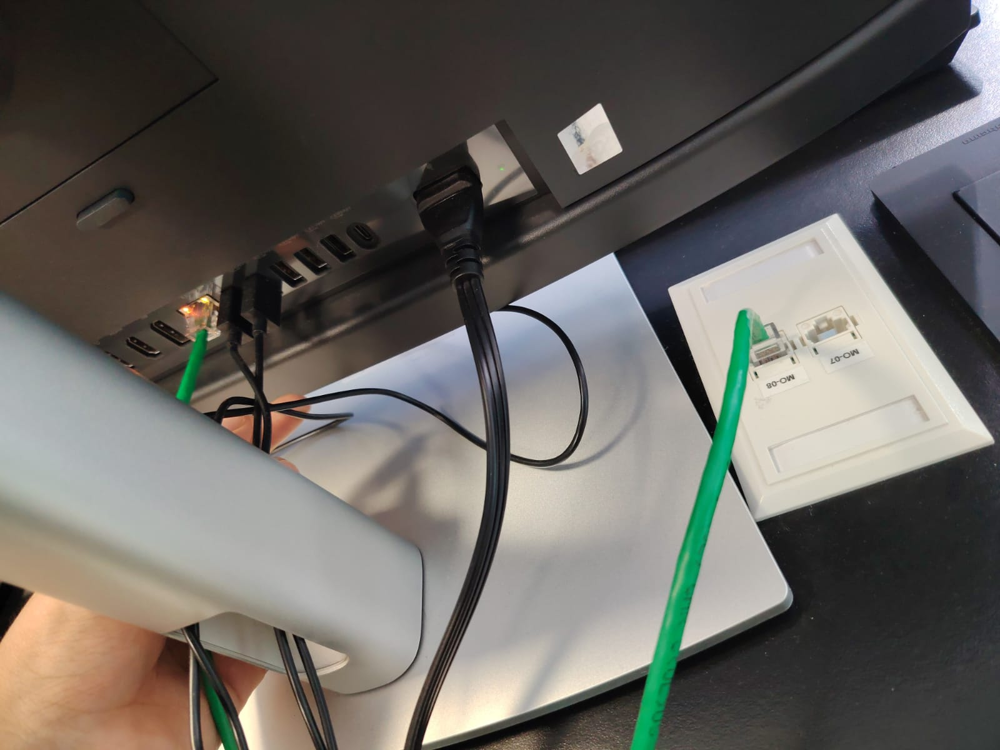

Then, we go over to the racks and connect the corresponding patch panel port to
a port on the ISP.

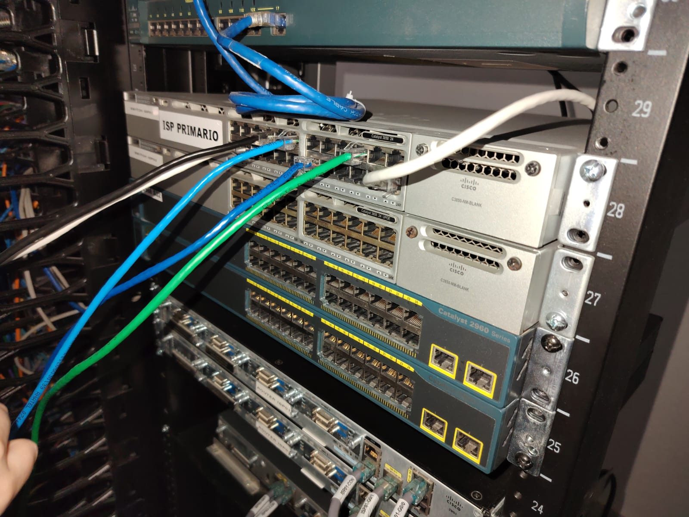

<Card title="Matching Ports" icon="information">
    Remember that every port on the table's patch panel is numbered and
    corresponds to the port with the same number on the racks. Always double
    check that you are plugging into matching numbers!
</Card>

## Connecting to the Router's Console Port

A brand new router has no IP address and no remote access configured, so the
only way to talk to it is through its **console port**. To do this from a
computer, we need a physical serial connection.

The computer has no traditional serial port, so we used a **USB to serial
adapter**. This adapter is plugged into the back of the computer, and a
console cable (serial on one end, RJ45 on the other) goes from the adapter to
a free port on the table's patch panel.

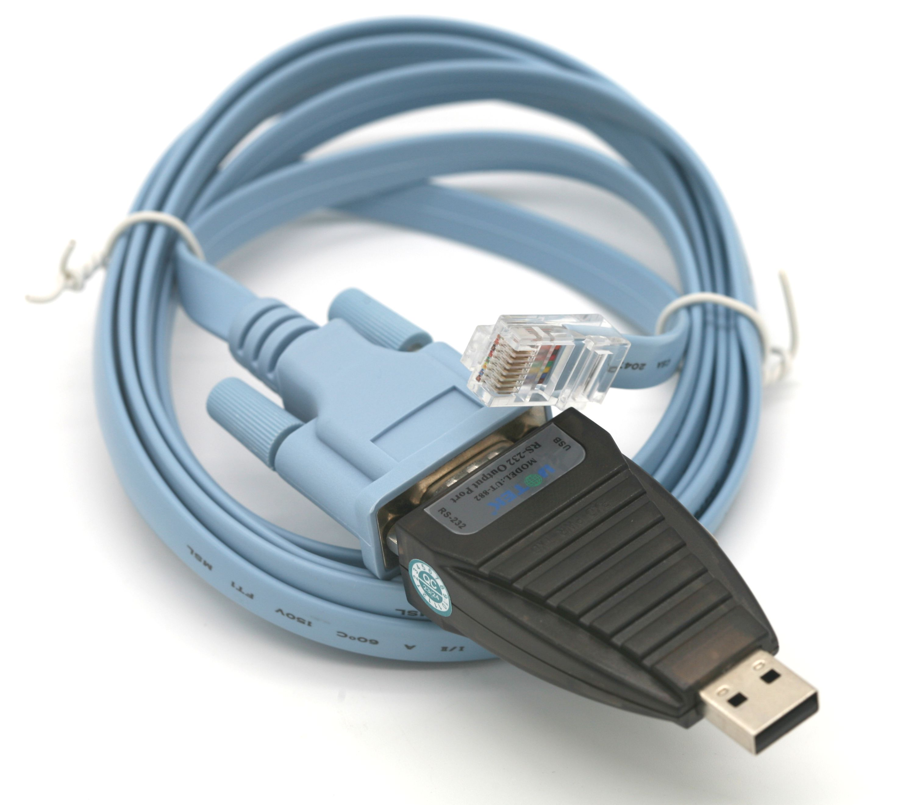

Then, on the racks, we connect the matching patch panel port to the **console
port** of the router.

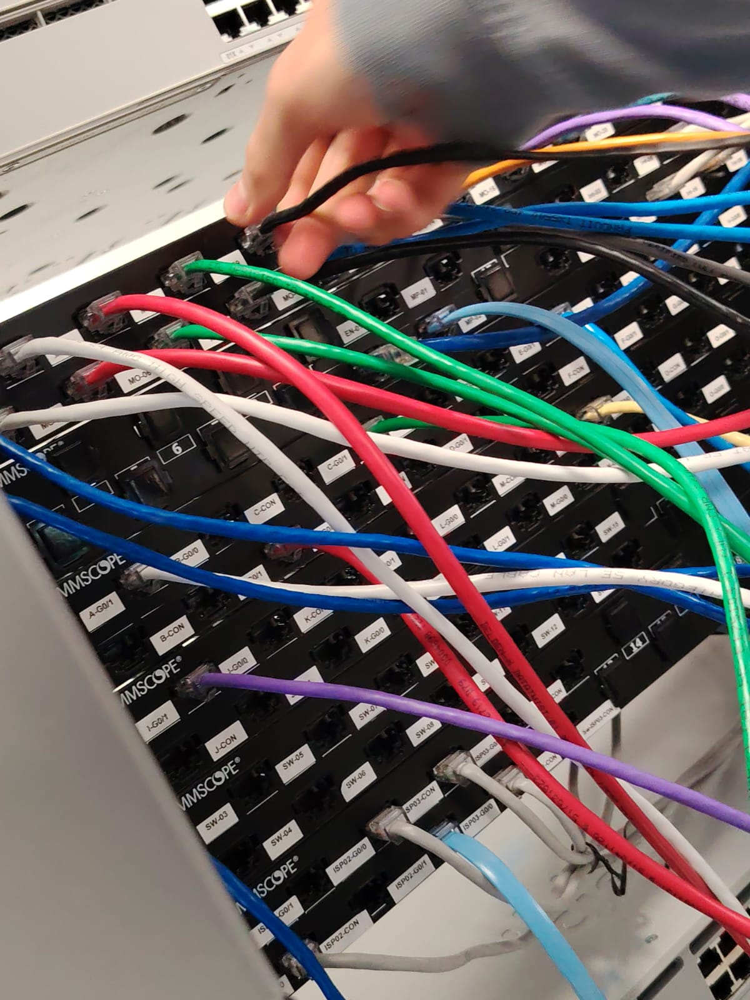

<Aside type='caution'>The console cable is not a regular network cable. Even
    though both ends use an RJ45 connector, plugging it into a normal network
    port will not work, and plugging a network cable into the console port
    won't either.</Aside>

### Connecting the Router to the ISP

At the start of the second session, the router had already been connected to
the ISP using the same steps that we followed last session. If you need a
refresher on how to interconnect these devices with a middle device, check out
[Lab 01](../lab01/).

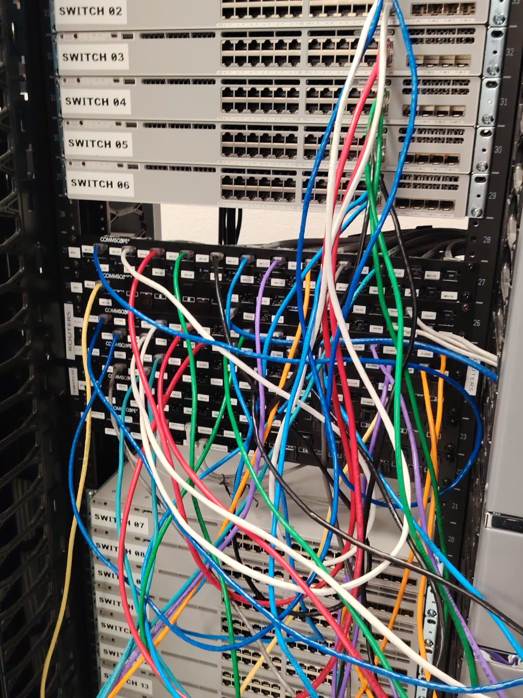

## Verifying Network Connectivity

Before touching any configuration, we should make sure that our computer still
has a working connection. We can do this in the same way that we did in the
first lab; for example, by checking the adapter status with `ncpa.cpl` and by
opening a website or running a speed test.

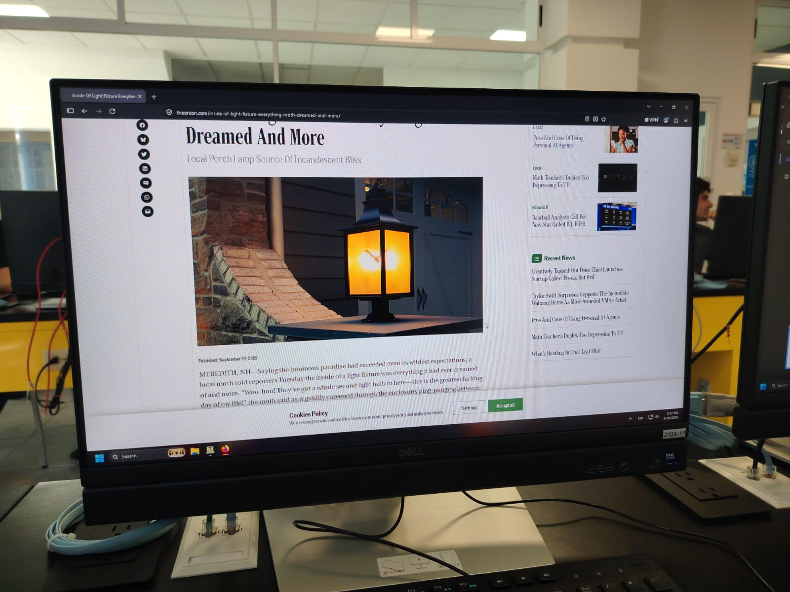

## Accessing the Router with TeraTerm

To communicate with the router through the console cable, we need a terminal
program that can speak over a serial connection. We used **TeraTerm**.

When TeraTerm opens, it asks us what kind of connection we want to make. Select
the **Serial** option and choose the port that Windows assigned to our USB
adapter. In our case, it was **COM5**.

<Card title="Finding Your COM Port" icon="magnifier">
    The COM number is assigned by Windows, so it may be different on another
    computer or if you plug the adapter into a different USB port. If you are
    not sure which one is yours, open the Device Manager and look under
    *Ports (COM & LPT)*.
</Card>

If everything went well, pressing Enter in the terminal window should display
the router's prompt.

## Loading the Router Configuration

Once connected, we pasted the full router configuration from Challenge 02 into
the terminal. It configures the hostname and domain, the local user accounts,
SSH, the WAN and LAN interfaces, the default route and the DHCP service.

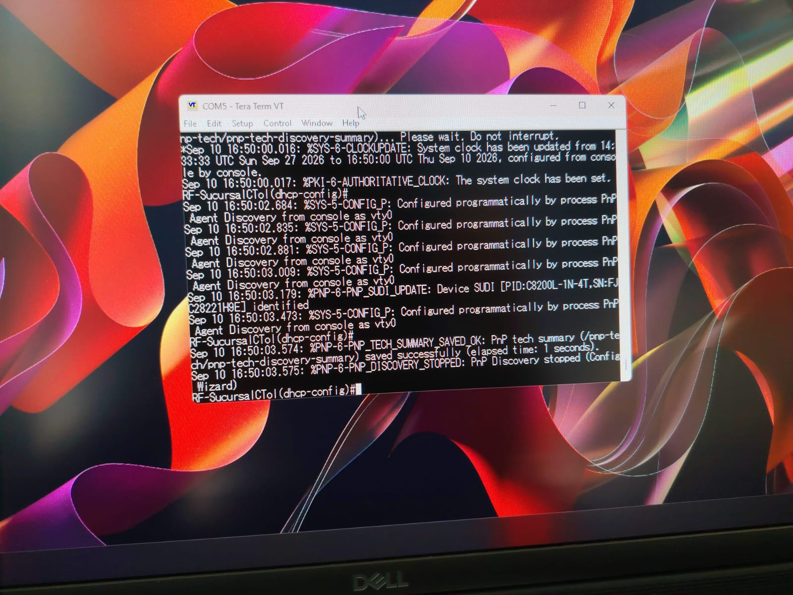

<Aside type='tip'>Pasting works here because lines starting with `!` are
    comments and are ignored by IOS. Just be careful to watch the output while
    the commands are running; if a command fails, IOS will print an error right
    below it.</Aside>

## Verifying Remote Access with SSH

Now for the moment of truth. Our configuration enabled SSH, so we should be able
to reach the router through the network instead of through the console cable.
From the computer, we opened an SSH connection to the router's LAN address,
**192.168.190.126**.

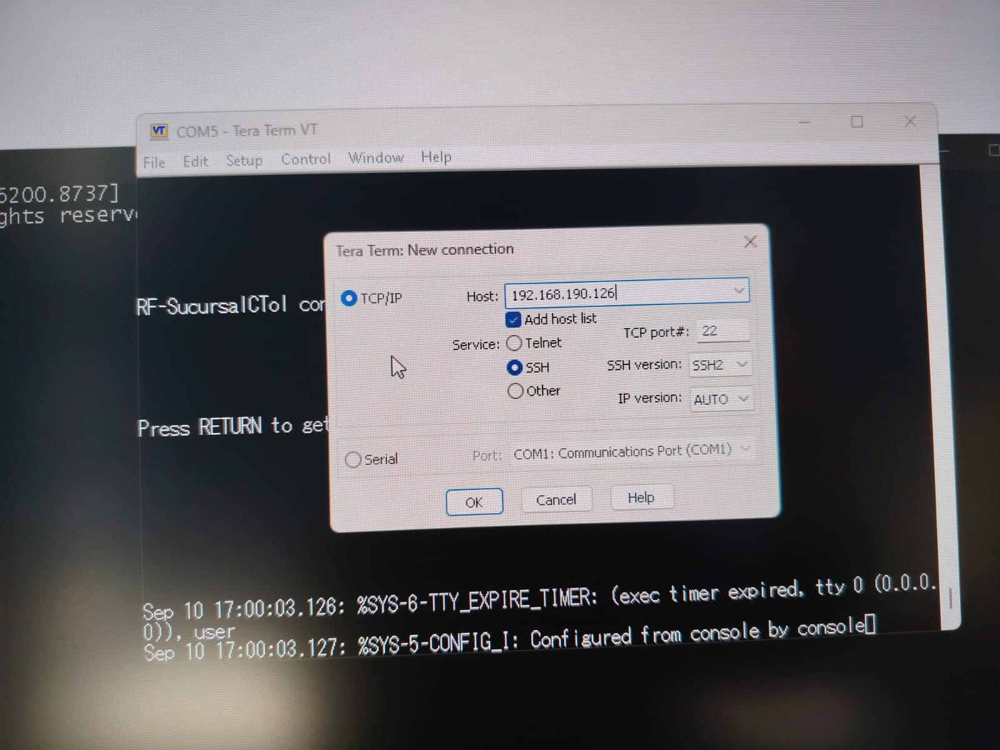

The first time we connect to a device over SSH, our client does not recognize
it and asks us whether we trust it and want to save its key. Since this is our
own router, we accept it.

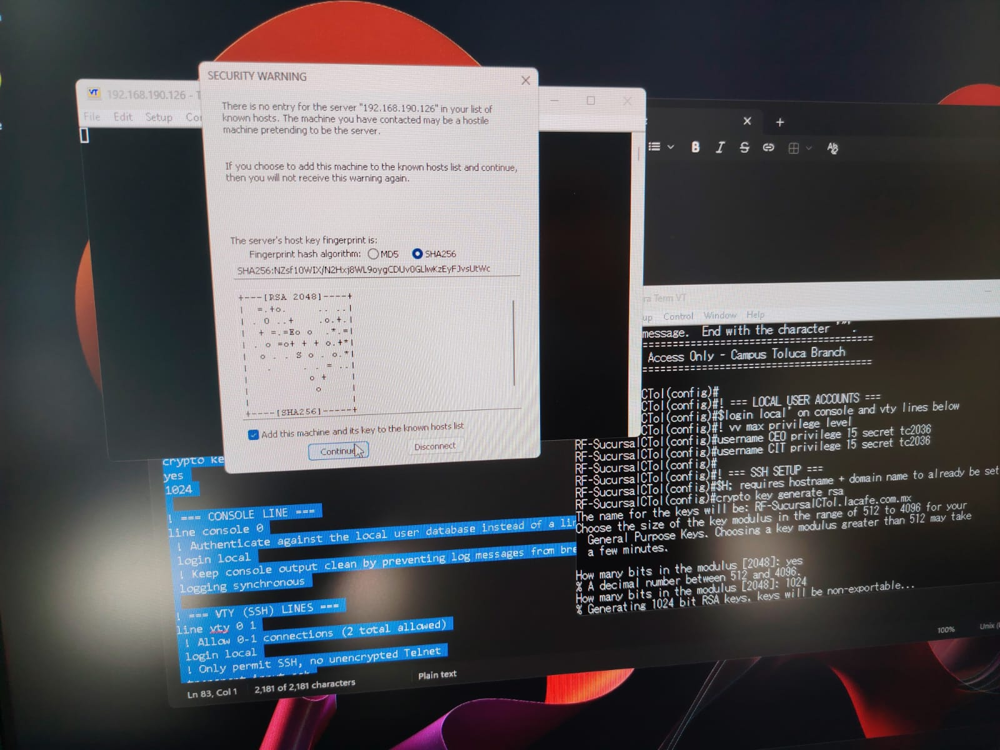

Then, we log in with one of the accounts that we defined in our configuration.

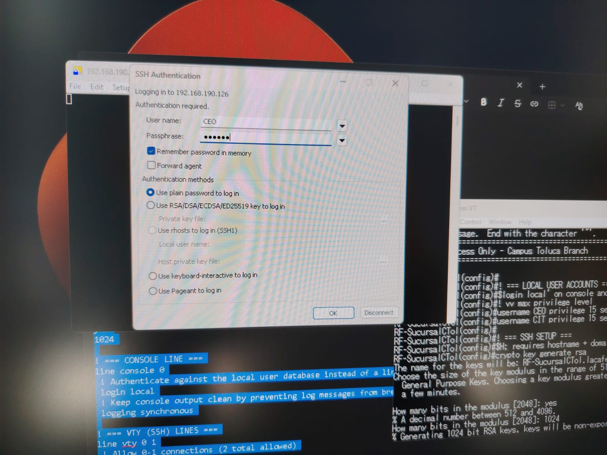

<Card title="Console vs. SSH" icon="laptop">
    The console connection works even if the router has no configuration at all,
    which makes it perfect for the initial setup or for recovering a device.
    SSH is more convenient and doesn't need a physical cable, but it only works
    once the router has an IP address, user accounts and encryption keys.
</Card>

### Reviewing the Running Configuration

To confirm that everything we pasted was applied correctly, we can display the
configuration that the router is currently running:

```ios title="Viewing the Configuration"
enable
show running-config
```

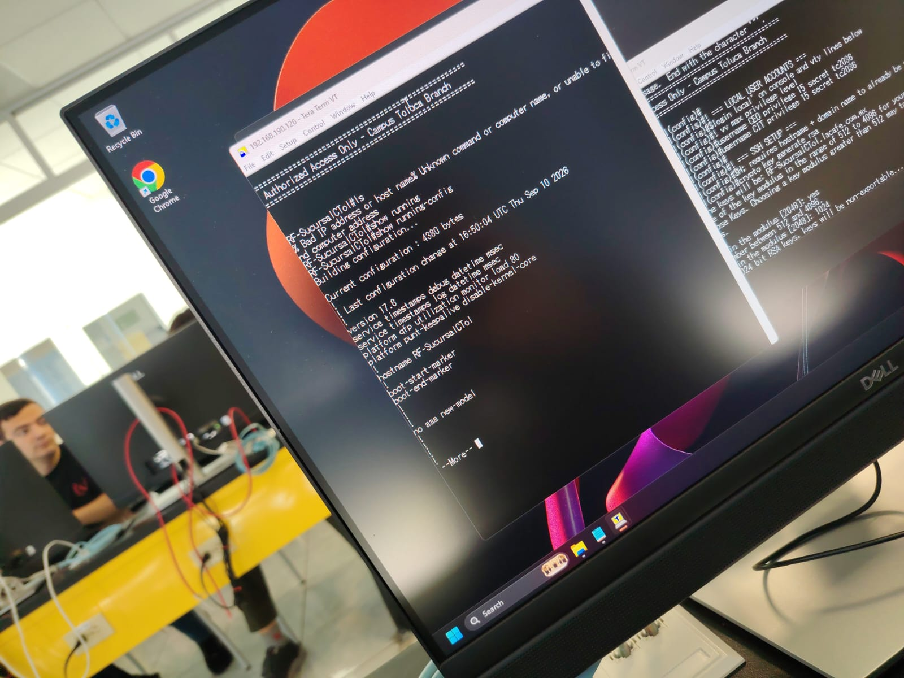

## Beginning the VLAN Configuration

The last part of the lab was to begin setting up a **VLAN**, so we could manage
the device through a dedicated management address. We started with VLAN 1's
interface and a default gateway:

```ios title="Remote Management Interface"
configure terminal

interface vlan 1
  description Remote management IP
  ip address 192.168.190.125 255.255.255.128
  no shutdown

exit
ip default-gateway 192.168.190.126
```

<Aside type='caution'>This section is incomplete! Unfortunately, the power went
    out in the laboratory before we could finish configuring the VLAN and
    testing it. This page will be updated once we can continue.</Aside>

<Card title="Watch Out for the DHCP Pool" icon="warning">
    The management address 192.168.190.125 belongs to the same range that our
    DHCP pool hands out, and we only excluded .0 - .10, .100 and .126. If we
    keep this address, we should also add
    `ip dhcp excluded-address 192.168.190.125` so that a client is never
    assigned the same address.
</Card>

This concludes the first part of lab 02!
